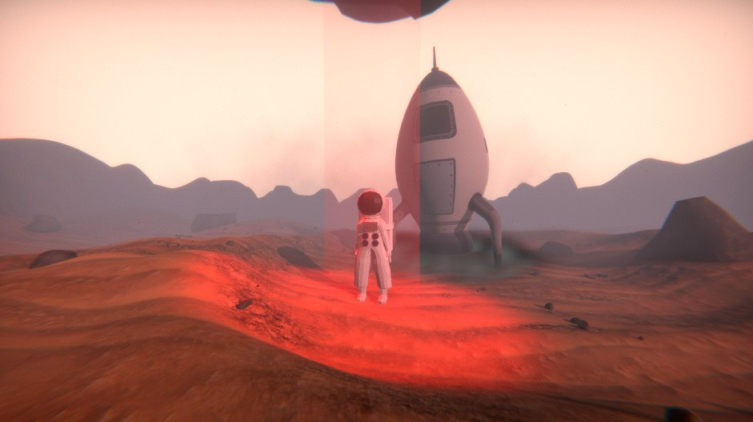

# JustGo!

First-person parkour platformer in Unity. Run timed courses, use jump pads and moving or breaking platforms, and post completion times to an online leaderboard.

## Links

- [Just Go! on itch.io](https://snon200.itch.io/just-go)
- [Parkour FPS controller on the Unity Asset Store](https://assetstore.unity.com/packages/slug/290830) (the movement system used in this game)
- [snon200 on itch.io](https://snon200.itch.io/)
- [snon200 on the Unity Asset Store](https://assetstore.unity.com/publishers/14718)

## Gameplay

- First-person movement with a parkour character controller
- Timed levels with a pause menu and end-of-level screen
- Checkpoints vs restart-on-fail volumes
- Player name stored locally and used on the leaderboard

## Project

- Engine: Unity 2023.2
- Company: snon
- Product name: JustGo!
- Gameplay scripts: `Assets/Scripts/`
- Controller package: `Assets/Parkour FPS - First Person Character Controller/`
- Leaderboard: `Assets/LeaderboardCreator/`

Two 4K floor textures in `Assets/Stone Floor Textures/Textures 4k/` are stored with Git LFS.

## Open in Unity

1. Install Unity 2023.2.20f1 (or a compatible 2023.2 editor) and Git LFS.
2. Clone the repo (`git lfs pull` if textures are pointer files).
3. Open this folder as a Unity project and press Play from the main menu scene.
